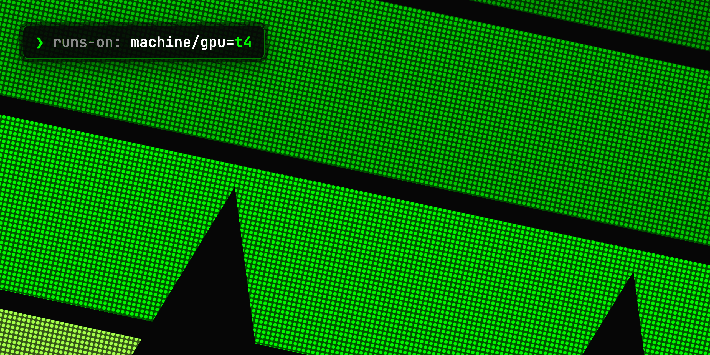

[](https://machine.dev)

# Machine workflow examples

Run GPU inference, training and evaluation from GitHub Actions with [Machine](https://machine.dev).
Each example includes a small workload, locked dependencies and a workflow you can run manually.

[](https://github.com/MachineDotDev/workflow-examples/actions/workflows/ci.yml)
[](LICENSE)

See [verification status](docs/verification.md) for the GPU runs behind each example.

## Examples

| Example | What runs | Output | Guide |
| --- | --- | --- | --- |
| [Batch object detection](batch-object-detection/) | DETR inference on two images | Detection boxes and labels | [Read](https://machine.dev/docs/use-cases/gpu-object-detection/?utm_source=github&utm_medium=oss&utm_campaign=2026-11-workflow-examples&utm_content=batch-object-detection) |
| [Parallel hyperparameter tuning](parallel-hyperparameter-tuning/) | Four ResNet50 configurations on CIFAR-10 | Losses for each configuration | [Read](https://machine.dev/docs/use-cases/parallel-hyperparameter-tuning/?utm_source=github&utm_medium=oss&utm_campaign=2026-11-workflow-examples&utm_content=parallel-hyperparameter-tuning) |
| [Supervised fine-tuning](supervised-fine-tuning/) | LoRA training on SmolLM2 | Adapter and resumable checkpoints | [Read](https://machine.dev/docs/use-cases/llm-supervised-fine-tuning/?utm_source=github&utm_medium=oss&utm_campaign=2026-11-workflow-examples&utm_content=supervised-fine-tuning) |
| [GRPO fine-tuning](grpo-fine-tuning/) | Arithmetic rewards on SmolLM2 generations | Adapter and resumable checkpoints | [Read](https://machine.dev/docs/use-cases/grpo-fine-tuning/?utm_source=github&utm_medium=oss&utm_campaign=2026-11-workflow-examples&utm_content=grpo-fine-tuning) |
| [LLM evaluation gate](llm-evaluation/) | A candidate answerer against a baseline on 500 ARC Easy questions | Per-question answers and a pass/fail regression decision | [Read](https://machine.dev/docs/use-cases/language-model-arena/?utm_source=github&utm_medium=oss&utm_campaign=2026-11-workflow-examples&utm_content=llm-evaluation) |

## Run an example

1. Create a repository from this template.
2. Follow the [Machine quickstart](https://machine.dev/docs/quickstart/). Install the Machine GitHub App for your repository and finish account setup. Check your team's available credits and runner capacity.
3. Open **Actions**, choose an example and select **Run workflow** on `main`.
4. Download the output from the run's **Artifacts** section.

No Hugging Face token is needed for these public models. The training jobs save adapters to GitHub artifacts and don't publish models.

GPU jobs incur Machine usage charges. Each job stops after 30 minutes; the tuning matrix starts four jobs at once. A cancelled or failed job can still incur charges. The defaults are small enough to check the execution path, but they aren't useful training runs or reliable model comparisons.

## Runner labels

The workflows use Machine's packed label format:

```yaml
runs-on: machine/id=${{ github.run_id }}-${{ github.run_attempt }}-training/gpu=t4
```

The ID includes the run, attempt and job identity. Matrix workflows also include their matrix values. See [Actions syntax](https://machine.dev/docs/reference/actions-syntax/) for selectors and [runner configuration](https://machine.dev/docs/platform-specifications/configuration/) for supported hardware. You can add `/tenancy=spot` when the workload can tolerate interruption; these first runs use the default tenancy so an interruption doesn't obscure a setup failure.

## Development

Install [uv](https://docs.astral.sh/uv/getting-started/installation/) and run:

```sh
uv sync --locked --only-group dev
uv run --no-sync pre-commit install
uv run --no-sync pre-commit run --all-files
```

GPU scripts require Linux x86-64, Python 3.12 and an NVIDIA GPU. PyTorch uses the CUDA 12.6 wheel index on Linux. The lock also supports macOS ARM for CPU validation, but the example scripts deliberately fail without CUDA.

See [contributing](CONTRIBUTING.md), [workflow controls](docs/workflows.md) and [source attribution](docs/sources.md).
